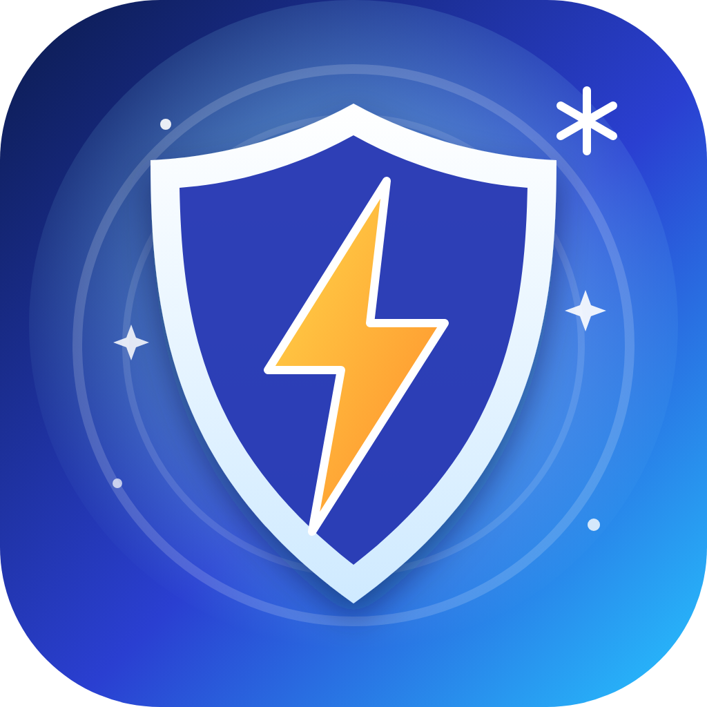
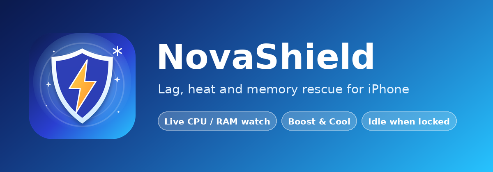

<p align="center">
  
</p>

<h1 align="center">NovaShield</h1>

<p align="center"><b>Performance and thermal rescue for lag, heat and memory pressure.</b><br>
Rootless tweak for iOS 15+ (Dopamine / palera1n rootless), made for the iPhone 7 Plus.</p>

<p align="center"></p>

## What it does

NovaShield is fully automatic. There is no dialog, no button and nothing to tap.

| Feature | How it works |
| --- | --- |
| **Zero standby drain** | Listens to `com.apple.springboard.hasBlankedScreen`. When the screen turns off the timer is cancelled, the indicator is removed and anything NovaShield paused is resumed. Nothing runs or is scheduled while locked. |
| **Quiet monitoring** | While the screen is on: CPU load (`host_statistics` deltas), memory saturation (`host_statistics64`) and thermal state, every 5 s, slowing to every 10 s once the phone has been calm. Low-priority queue and a wide timer leeway so wake-ups are batched with the system's own. |
| **Auto Boost** | If the CPU, memory or temperature stays high for about 10 s, it runs Boost & Cool by itself, at most once every 90 s. |
| **Tick indicator** | After a boost that really changed something, a tiny liquid-glass pill with green ticks shows the proof for 2.5 s, for example `✓ RAM 93→88%   ✓ 2 apps closed   ✓ 4 paused`. If nothing changed, nothing is shown. Touches pass through it, and it turns upright for landscape games. |
| **Gaming Optimization Mode** | Boosts about 5 s after Mobile Legends, Telegram or FaceTime come to the front and keeps daemons paused while they stay in front. |
| **Settings pane** | Master switch, CPU threshold (60 to 95 %), memory reaction, gaming mode, what the boost does, tick indicator on/off, position and time, Test Indicator, reset and respring. |

### What the boost does

1. Clears memory caches in SpringBoard (`malloc_zone_pressure_relief`, URL cache, memory warning).
2. Closes background apps that are safe to close. It never closes the front app, calls, FaceTime, music or anything playing, navigation, Telegram, WhatsApp and similar chat apps, or most Apple apps.
3. Pauses background analysis and indexing daemons (`photoanalysisd`, `mediaanalysisd`, `parsecd`, `suggestd`, `searchd`, `duetexpertd` and a few more) with `SIGSTOP` for 90 s, then resumes them. Resumed on screen off, on disable, and on the next SpringBoard start if it ever crashed.
4. Tries to raise the foreground app's priority (`QOS_CLASS_USER_INTERACTIVE` for SpringBoard itself, `setpriority` for the app).

## Honest limits

- SpringBoard runs as the `mobile` user. NovaShield **cannot** touch root daemons such as `thermalmonitord`, change kernel thermal management or fix I2C bus hangs. It lowers the load that triggers them.
- Raising another app's priority is normally refused by iOS for unprivileged processes. The indicator shows "priority up" only when it actually worked.
- The memory warning level (92 % saturation) and the paused-daemon list are sensible defaults, not measurements from your device.
- It uses private SpringBoard APIs looked up at runtime, so an action may quietly do nothing on an iOS version where they changed.
- Mobile Legends and Telegram bundle IDs can differ by region. To change the list, write an array of bundle IDs to the `gamingApps` key in `com.kwarnu.novashield`.

## Install

Download the `.deb` from the **Releases** page (or the `NovaShield-deb` artifact in **Actions**), install it with Sileo, Zebra or Filza, and respring. Package: `com.kwarnu.novashield`, architecture `iphoneos-arm64`.

Requires iOS 15.0 or later, a rootless jailbreak, `mobilesubstrate` (ElleKit) and `preferenceloader`.

## Settings

Settings > NovaShield

| Setting | Default |
| --- | --- |
| Enable NovaShield | On |
| CPU Threshold | 80 % |
| Also React to High Memory | On |
| Gaming Optimization Mode | On |
| Close Background Apps | On |
| Pause Background Daemons | On |
| Show Tick Indicator | On |
| Indicator Position | Top |
| Indicator Time | 2.5 s |

## Architecture

```
Tweak.m                       SpringBoard tweak (screen state, telemetry, auto boost, tick indicator)
NovaShield.plist              MobileSubstrate filter (SpringBoard only)
prefs/                        PreferenceLoader bundle (Root.plist + list controller)
layout/                       PreferenceLoader entry and icons
depictions/native/            Sileo native depiction
.github/workflows/build.yml   macOS runner: Theos + SDKs, rootless build, release upload
```

Settings are stored with CFPreferences in `com.kwarnu.novashield` and applied live through the Darwin notification `com.kwarnu.novashield/prefschanged`.

## Build

Needs [Theos](https://theos.dev).

```sh
make package FINALPACKAGE=1 THEOS_PACKAGE_SCHEME=rootless
```

GitHub Actions builds the package on every push to `main` and attaches it to the `v<version>` release.

## License

MIT
